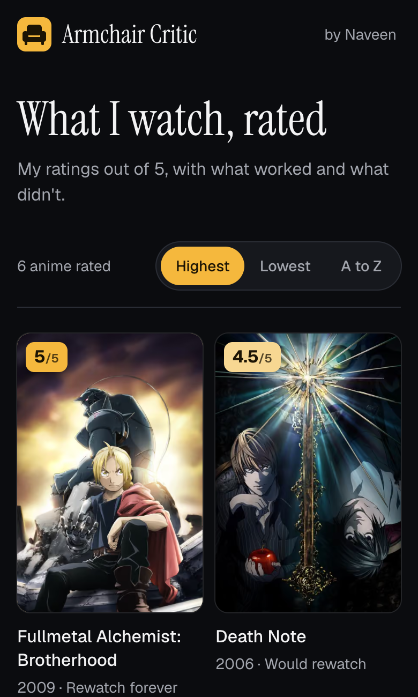

# Armchair Critic

I rate what I watch out of 5, with a rewatch verdict and what worked and what didn't. Anime and TV shows so far. Movies, web series and singers come later.

Built with Next.js, TypeScript and Tailwind. Posters and details come from AniList (anime) and TVmaze (TV shows) at build time, so every page is static.



## Run it

Needs Node 22.18 or newer.

```bash
npm install
npm run dev
```

## Add a rating

1. Find the ID: `npm run find -- "frieren"` for anime, or `npm run find -- --type show "breaking bad"` for TV shows.
2. Add an entry to `src/data/entries.ts`.
3. Run `npm run check` and `npm run build`.

The build stops with a plain message if an entry is wrong: a rating outside 0.5 to 5, the wrong number of points, an ID the source doesn't know, or an em or en dash.

## Phases

1. **Anime.** Poster grid, sorting, one page per title, data from AniList in one request per build.
2. **TV shows.** Data from TVmaze (free, no key), a filter for Anime and TV shows, and credit for both sources in the footer.
3. **Movies, next.** Data from TMDB. Needs a free `TMDB_TOKEN` in `.env.local` and in the Vercel project settings, plus TMDB credit on the site.
4. **Later.** Web series (TVmaze) and singers (Deezer).
